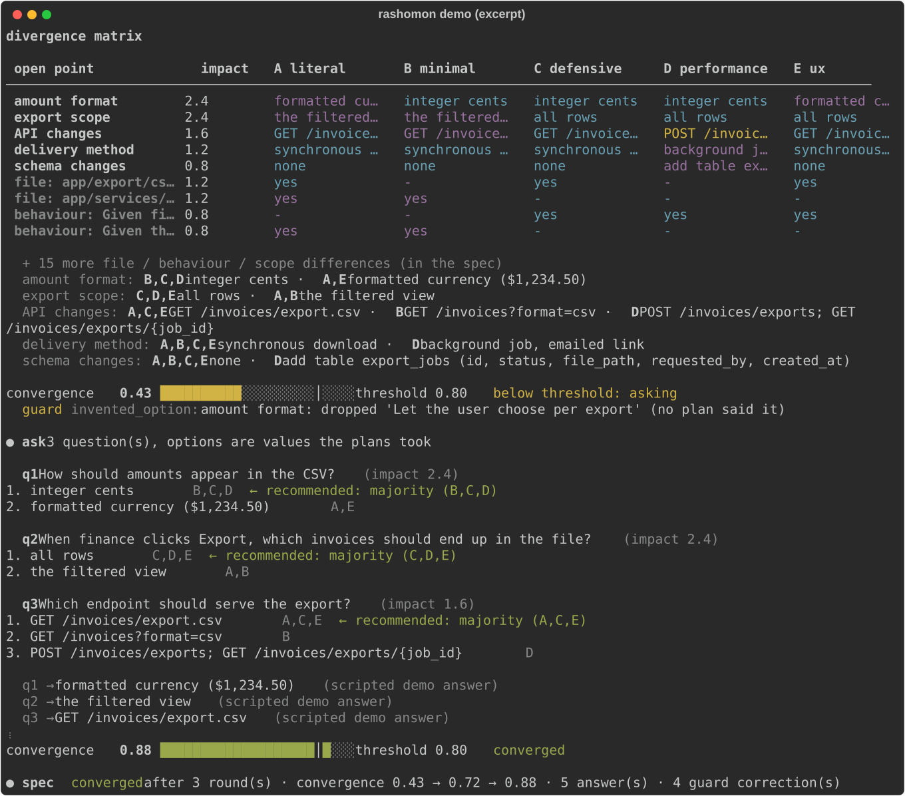
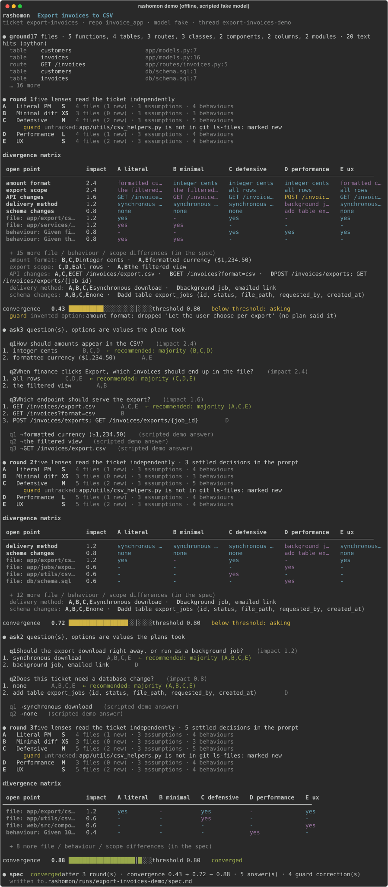
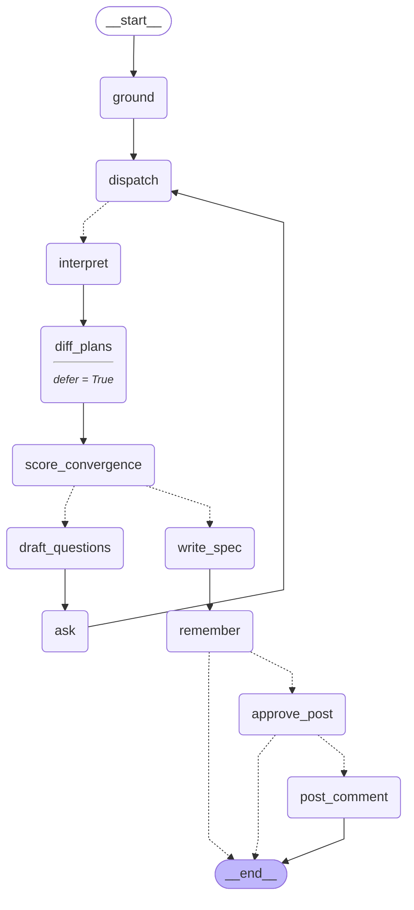

<div align="center">

# rashomon

**Five independent readings of a vague ticket, grounded in your repo. Where they disagree is the short list of questions worth asking before anyone writes code.**

[](https://github.com/flaviorg/rashomon/actions/workflows/ci.yml)
[](LICENSE)
[](pyproject.toml)
[](https://github.com/langchain-ai/langgraph)

[Quick start](#quick-start) · [How it works](#how-it-works) · [The loop](#the-loop) · [Guardrails](#guardrails) · [Backtest](#backtest) · [spec-kit](#as-a-drop-in-for-speckitclarify) · [Usage](docs/usage.md) · [Architecture](docs/architecture.md) · [Changelog](CHANGELOG.md)

</div>

"Add an Export button to the invoices page" sounds clear until five engineers build it. One exports the filtered view, another exports every row. One writes cents, another writes `$1,234.50`. One adds a background job and a table. Each of those is a fine reading of the ticket, and each is a rework cycle if it is the wrong one.

`rashomon` makes that disagreement visible *before* coding. It grounds the ticket in your repository (routes, tables, components, with `file:line` evidence), asks five independent lenses for a concrete, typed plan, and diffs the plans in pure code. The points where the plans split become multiple-choice questions whose options are values the plans actually took. Your answers go back into the next round, and the loop stops when a convergence score that **code computes** crosses a threshold. The output is a Markdown spec with settled assumptions, acceptance criteria and test stubs.

> **Status: alpha.** The graph, the diff, the scoring, the guards and the persistence are tested offline with a scripted stand-in model. I have not yet measured question quality with a real model on real tickets; the [backtest](#backtest) exists to do exactly that, and its bundled numbers only prove the mechanics.

<p align="center">
  
</p>

<p align="center"><sub>Real, unedited output of <code>rashomon demo</code> (offline, scripted fake model), rendered to SVG by <a href="scripts/gen_demo_svg.py"><code>scripts/gen_demo_svg.py</code></a>, middle trimmed at the <code>⋮</code>. The scripted model also "helpfully" invents an answer option nobody proposed; the validator drops it.</sub></p>

<details>
<summary>Full transcript of the same run (three rounds, five questions, converged)</summary>

<p align="center"></p>

Plain text: [docs/media/demo.txt](docs/media/demo.txt). The spec the run wrote: [docs/sample-spec.md](docs/sample-spec.md).

</details>

## Quick start

Needs Python 3.11+ and git. No API key and no network after install.

```bash
git clone https://github.com/flaviorg/rashomon.git && cd rashomon
python3.12 -m venv .venv && source .venv/bin/activate   # any Python >= 3.11
pip install -e .
rashomon demo
```

The demo grounds `examples/tickets/export-invoices.md` in the bundled `examples/invoice_app`, runs three rounds, answers the questions with scripted choices and writes the spec under `.rashomon/runs/<thread>/spec.md`. Add `--interactive` to answer yourself (pick different options and watch the next round follow them). Run it twice: the second run is grounded from cache, and every question recommends what you decided last time.

On your own repo with a real model:

```bash
export ANTHROPIC_API_KEY=...
rashomon run GH-123 --repo .            # a GitHub issue, fetched with gh
rashomon run docs/tickets/export.md     # or any text / Markdown file
```

Exit code `0` means converged, `1` finished without converging, `2` error, `3` paused waiting for answers.

## Why this exists

Clarifying questions are cheap; the expensive part is knowing *which* ones to ask. Ask an LLM "what is ambiguous here?" and you get a generic checklist (error handling? permissions? i18n?). Most of it does not matter for this ticket, and the one question that would have saved a week is item eleven.

rashomon makes three bets:

1. **Disagreement is the signal.** If five independent, concrete plans agree on something, asking about it wastes the product owner's time. If they split two against three, that split is exactly the ambiguity that causes rework. Asking only where plans diverge keeps the list short and specific.
2. **Plans must be concrete enough to diff.** Each lens returns a typed `Plan`: files touched, API and schema changes, Given/When/Then behaviours, out-of-scope items, a size, and every judgement call as an `{topic, choice}` assumption. Free text cannot be diffed; this can.
3. **The model proposes; code decides.** The model writes plans and phrases questions. Code grounds the ticket, checks every path against `git ls-files`, clusters and diffs the plans, picks what to ask, validates every answer option, computes convergence and decides when to stop. The model never declares convergence, and it never writes to your tracker.

**Why not just ask one model for clarifying questions?** One model, one pass, gives you its own blind spots. Five lenses that optimize for different things (literal reading, smallest diff, unhappy paths, scale, the person clicking the button) disagree in useful places, and the disagreement is measured, not asserted.

## Highlights

- **Map-reduce with `Send` and a deferred fan-in.** `dispatch` fans out one `Send("interpret", ...)` per lens; `diff_plans` is added with `defer=True`, so it runs once, after all five plans are in, every round.
- **Grounding with file:line evidence, cached.** `ground` indexes routes, tables, columns, components, classes and functions (Python's `ast` for `.py`, heuristics for SQL and JS/TS) and searches with ripgrep when it is installed, or a Python scan with the same semantics. It has a `CachePolicy` keyed on the repo's HEAD sha (a content hash when the tree is dirty) plus the ticket hash, backed by `SqliteCache`.
- **A divergence matrix, in pure code.** Topics are clustered by token Jaccard (so "export scope" and "scope of the export" are one topic), lenses are grouped by choice, and every split gets an impact score: dimension weight times how evenly the plans split.
- **Convergence is a number, not an opinion.** Weighted mean pairwise Jaccard across seven dimensions. `score_convergence` decides: converged, ask, round limit, nothing askable, or prediction only.
- **Questions with validated options.** The top three divergences become multiple-choice questions. The model only phrases them; any option no plan proposed is dropped, any value a plan proposed and the model left out is restored, and answers go through `interrupt(..., response_schema=...)` with a generated `Literal` model, so an answer outside the options is rejected and the question stays open.
- **Answers can arrive days later.** `SqliteSaver` checkpoints every step. `rashomon run --no-input` pauses with exit code 3; `rashomon answer THREAD q1=2 q2=1` continues it from any process, any time.
- **Decisions become precedent.** Settled answers are written to the LangGraph `Store` (`SqliteStore`) per repo. Later tickets see them in the lens prompts, and a question on the same topic recommends the earlier decision.
- **Nothing reaches the tracker without approval.** `--post` adds an `approve_post` interrupt; `post_comment` runs only after an explicit yes, and checks the recorded approval again before calling `gh`.
- **The diagram cannot drift.** The Mermaid graph below is generated from the compiled graph, and a test fails if the README is out of date.

## How it works

Generated from `graph.get_graph().draw_mermaid()` by [`scripts/gen_graph.py`](scripts/gen_graph.py). Dotted edges are conditional.

<!-- graph:start -->

<!-- graph:end -->

| Node | Kind | What it does |
| --- | --- | --- |
| `ground` | code, cached | Builds the context pack: tracked files, entities matching the ticket with `path:line`, text hits. |
| `dispatch` | code | Starts a round, loads precedent from the Store, fans out five `Send("interpret")`. |
| `interpret` | **LLM** ×5 | One lens, one typed `Plan`. The plan then goes through the [guard](#guardrails). |
| `diff_plans` | code, `defer=True` | Clusters and diffs the round's plans into the divergence matrix. |
| `score_convergence` | code | Weighted Jaccard convergence; picks what to ask; decides the next step. |
| `draft_questions` | **LLM** | Phrases the selected divergences as questions. Options are validated against the plans. |
| `ask` | interrupt | Pauses with the questions and a response schema. Answers become binding settled decisions. |
| `write_spec` | code | Markdown spec: settled assumptions, acceptance criteria, edge cases, changes, test stubs. |
| `remember` | code | Writes the answers to the Store as precedent. |
| `approve_post` | interrupt | Only with `--post` on a GitHub ticket: asks before writing to the tracker. |
| `post_comment` | code | Posts the spec as an issue comment via `gh`, only with a recorded approval. |

More on state, clustering, scoring and persistence: [docs/architecture.md](docs/architecture.md).

## The lenses

| | Lens | Optimizes for |
| --- | --- | --- |
| A | Literal PM | Exactly what the words say, no more. |
| B | Minimal diff | Reuse what exists. No new tables or dependencies unless unavoidable. |
| C | Defensive | Empty results, huge inputs, bad data, escaping, permissions. |
| D | Performance | 100x today's data: query cost, memory, streaming, background work. |
| E | UX | Where the control lives, what the user sees while waiting, what the output looks like. |

Each lens sees the same ticket and context pack and none of the other plans. Settled decisions are in every prompt from round 2 on, and the guard enforces them.

## The loop

After every round, `score_convergence` evaluates these in order; the first that applies decides:

| Decision | When | Then |
| --- | --- | --- |
| `error` | Fewer than two plans came back. | Spec with what there is. |
| `converged` | Convergence ≥ `--threshold` (default 0.80). | Write the spec. |
| `predicted` | `mode=predict` (backtest). | Stop after round 1, no questions. |
| `max_rounds` | Round ≥ `--max-rounds` (default 3). | Spec, with the remaining splits under "Still open". |
| `nothing_to_ask` | No askable divergence left (only files or behaviours differ). | Spec. |
| `ask` | Otherwise. | Phrase the top 3 divergences, interrupt, re-dispatch. |

Convergence is the weighted mean, over seven dimensions, of the mean pairwise Jaccard similarity between plans:

| Dimension | Weight | Compared as | Askable |
| --- | --- | --- | --- |
| assumptions | 3.0 | set of (topic cluster, choice cluster) | yes |
| API changes | 2.0 | set of clustered items ("none" is a value) | yes |
| schema changes | 2.0 | set of clustered items | yes |
| files | 1.5 | set of exact paths | no |
| behaviours | 1.0 | set of clustered Given/When/Then | no |
| size | 1.0 | ordinal XS..XL | no |
| out of scope | 0.5 | set of clustered items | no |

Files and behaviours that only some plans include are shown in the matrix and land in the spec (as "edge cases raised by fewer lenses"), but they are consequences, not questions: once the product owner settles the export scope, the files follow.

## Guardrails

Code-side checks, each with unit tests:

| Check | Where | What happens |
| --- | --- | --- |
| Paths vs `git ls-files` | `guard.check_paths` | A plan that "modifies" an untracked file gets it relabelled `new` (and a note). A `new` file that exists becomes `modify`. Absolute paths and `..` are dropped. |
| Settled decisions | `guard.enforce_settled` | A plan that contradicts an answer is corrected to the answer, with an `overrode` note. A lens cannot reopen a closed question. |
| Size caps | `guard.guard_plan` | At most 40 files and 30 items per list, 300 characters per string. |
| Invented options | `questions.validate` | Options no plan proposed are dropped; options the model left out are restored. |
| Answer schema | `ask` | `interrupt(..., response_schema=Answers)` with one `Literal` per question: anything else raises and nothing is saved. |
| Tracker writes | `approve_post` + `post_comment` | Only with `--post`, only for GitHub tickets, only after an explicit approval, checked twice. |
| Convergence | `score_convergence` | Computed from the plans. Nothing the model says can end the loop. |

## Backtest

Do the divergences rashomon finds predict how requirements *actually* changed? `rashomon backtest` runs round 1 on the original text of closed issues (prediction mode: no questions, no Store writes) and checks each later requirement change against the top three predicted divergences:

- **change recall**: share of later changes that land on a predicted divergence;
- **question precision**: share of predicted questions that some later change landed on.

```bash
rashomon backtest                                   # bundled sample: mechanics only
rashomon backtest issues.jsonl --repo ../app        # your dataset: {"id","title","body","changes":[...]}
rashomon backtest --gh owner/name --limit 30        # closed GitHub issues, comments as changes
```

On the bundled sample with the scripted model: 2 issues, 4 later changes, recall 50%, precision 67%. Those numbers only show the pipeline works. Matching is token containment (deterministic and conservative), and comments are a noisy stand-in for requirement changes. Treat real runs as a signal, not a benchmark.

## As a drop-in for `/speckit.clarify`

[spec-kit](https://github.com/github/spec-kit)'s `/speckit.clarify` scans a spec against a taxonomy and asks up to five questions. rashomon answers the same need from the other side: it asks only where independent plans disagree, and the options are concrete plans, not categories. It writes answers in the same format, so the rest of the spec-kit flow (`/speckit.plan`) reads them unchanged:

```bash
rashomon run specs/001-invoice-export/spec.md --repo . --speckit specs/001-invoice-export/spec.md
```

This appends to (or creates) the spec's `## Clarifications` section:

```markdown
## Clarifications

### Session 2026-11-21

- Q: When finance clicks Export, which invoices should end up in the file? → A: the filtered view
- Q: How should amounts appear in the CSV? → A: formatted currency ($1,234.50)
```

To use it from an agent instead of the built-in command, copy [`examples/speckit/rashomon.clarify.md`](examples/speckit/rashomon.clarify.md) into your agent's commands folder.

## Usage

```text
rashomon run TICKET [options]        GH-123, owner/repo#123, or a file
rashomon demo [--interactive]        the bundled ticket and repo, offline
rashomon answer THREAD q1=2 q2=...   answer a paused run (any time later)
rashomon resume THREAD               answer a paused run interactively
rashomon backtest [DATASET]          did divergences predict later changes?
rashomon decisions [--repo PATH]     past decisions stored for a repo
rashomon graph                       Mermaid diagram of the real graph
```

| Flag | Default | Meaning |
| --- | --- | --- |
| `--repo` | `.` | Repository to ground the ticket in. |
| `--model` | see below | `provider:model`, or `fake`. |
| `--threshold` | `0.8` | Convergence needed to stop asking. |
| `--max-rounds` | `3` | Rounds before giving up. |
| `--no-input` | off | Never prompt: pause with exit code 3 and print the thread id. |
| `--out` | none | Also write the spec here. |
| `--speckit` | none | Append answers to a spec-kit `spec.md` as Clarifications. |
| `--post` | off | Offer to post the spec on the GitHub issue (approval interrupt). |
| `--state-dir` | `.rashomon` | Checkpoints, Store and cache. Add it to your `.gitignore`. |
| `--json` | off | Summary as JSON on stdout; progress goes to stderr. |

| Variable | Used for |
| --- | --- |
| `ANTHROPIC_API_KEY` | Anthropic models. If set and no model is chosen, the default is `anthropic:claude-sonnet-5-5`. |
| `RASHOMON_MODEL` | Model id (`provider:model`). `--model` wins over it. |
| `OPENAI_API_KEY`, `OPENAI_BASE_URL` | `openai:<id>`, or any OpenAI-compatible endpoint. |
| `OPENROUTER_API_KEY` | `openrouter:<vendor>/<model>`. |

With none set, the model is `fake`: offline, deterministic, and it only knows the bundled demo ticket. Details and examples: [docs/usage.md](docs/usage.md).

## Tests and quality

```bash
pip install -e ".[dev]"
make check     # ruff, format check, 79 offline tests, graph drift check
```

Everything runs offline against the scripted model, including the full three-round loop, pausing and resuming across processes through SQLite, the cache hit, Store precedent, invalid answers, the approval gate and the CLI. CI runs on Python 3.11, 3.12 and 3.13.

## Project structure

```text
src/rashomon/
  graph.py       the LangGraph graph: nodes, routing, interrupts
  ground.py      repo grounding: files, symbols, search, context pack
  guard.py       code-side checks on every plan
  diff.py        clustering and the divergence matrix
  score.py       convergence
  questions.py   selection, validation, response schema
  spec.py        Markdown spec and spec-kit Clarifications
  memory.py      Store: past decisions as precedent
  runtime.py     SQLite checkpointer, store and cache; the drive loop
  backtest.py    prediction vs later requirement changes
  tracker.py     gh: read issues, post comments (gated)
  llm/           port, LangChain adapter, scripted fake, demo script
examples/        invoice_app sample repo, ticket, backtest data, spec-kit command
scripts/         gen_graph.py, gen_demo_svg.py
```

## Roadmap

- Serve the graph with `langgraph dev` and expose `run`/`answer` as an MCP tool.
- Tree-sitter grounding for languages beyond Python, SQL and JS/TS.
- A real-model backtest on public repositories, published with its dataset.
- Free-text answers ("none of these"), turned into a new settled value by code.
- Per-lens model choice, so the five readings are not one model's five moods.

## Known limitations

- **The fake model only knows the demo ticket.** On any other ticket it returns five identical empty plans, which converge at once. Real questions need a real model.
- **Question quality is unmeasured.** The tests prove the graph, the diff and the guards, not whether a real model's lenses disagree in useful places.
- **Clustering is lexical.** Token Jaccard catches paraphrases that share words ("export scope" / "scope of the export"), not synonyms ("all rows" / "every invoice"). Two such plans look like a split. That over-asks rather than under-asks, which is the safer failure.
- **One model, five prompts.** The lenses are independent calls, but with the same model they share its blind spots.
- **Grounding is heuristic.** Python is parsed with `ast`; SQL and JS/TS use regexes. Other languages get text search only.
- **Backtest matching is token containment**, and GitHub comments are a noisy proxy for requirement changes.
- **Answers are multiple choice only.** If none of the options is right, answer the closest and edit the spec, or rewrite the ticket and run again.

## License

[MIT](LICENSE) © 2026 Flavio Gouveia

---

<p align="center"><sub>If this is useful, a star helps others find it. Issues and PRs are welcome, see <a href="CONTRIBUTING.md">CONTRIBUTING.md</a>.</sub></p>
