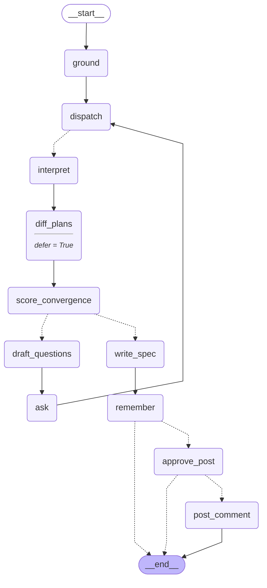

# Architecture

rashomon is one LangGraph `StateGraph` with a map-reduce step inside a human-in-the-loop cycle.
Model calls happen in two nodes (`interpret`, `draft_questions`). Everything that decides
anything is plain Python with unit tests.

<!-- graph:start -->

<!-- graph:end -->

## State

`graph.State` is a `TypedDict`. Inputs (`ticket`, `ticket_hash`, `fingerprint`, `repo_path`,
`repo_key`, `threshold`, `max_rounds`, `mode`, `post`, `model`, `out`, `speckit`) are set once
by the CLI. Working keys:

| Key | Reducer | Holds |
| --- | --- | --- |
| `context` | replace | The context pack from `ground`. |
| `round` | replace | Current round, starting at 1. |
| `plans` | `operator.add` | Every guarded plan of every round, tagged with `lens` and `round`. |
| `analysis` | replace | The current round's divergence matrix and signatures. |
| `history` | `operator.add` | One entry per round: score, per-dimension scores, counts. |
| `pending` | replace | Divergences selected to ask, then the phrased questions. |
| `settled` | replace | Answers so far, keyed by divergence id. |
| `answered` | `operator.add` | The same answers as a log (Store, spec-kit, spec). |
| `notes` | `operator.add` | Every guard correction, with round and lens. |
| `tokens` | `operator.add` | Token spend (rough for the fake). |

Plans accumulate across rounds instead of being reset, so every earlier interpretation stays
inspectable in the checkpoint history; nodes read only `plans` where `round == state.round`.

## Fan-out and fan-in

`dispatch` is followed by a conditional edge that returns five `Send("interpret", LensTask)`.
`interpret` is registered with `input_schema=LensTask`, so each task sees only its lens, the
ticket, the context pack, the settled decisions and the precedent, never the other plans.
`diff_plans` is registered with `defer=True`: LangGraph runs it once, after every pending
`interpret` task of the round has finished, instead of once per incoming edge.

## Interrupts and resuming

`ask` calls `interrupt(payload, response_schema=Answers)`, where `Answers` is generated per
question set with `pydantic.create_model` and one `Literal[...]` field per question. LangGraph
validates the resume value against it: a wrong value raises `ValidationError`, nothing is
saved, and the same interrupt is still pending.

An interrupt re-runs its node from the top when resumed. That is why the model call that
phrases questions lives in `draft_questions` and `ask` only interrupts: resuming never calls the
model again, and the questions you answer are exactly the ones you were shown.

The checkpointer is `SqliteSaver` in `.rashomon/checkpoints.sqlite`. `rashomon answer THREAD ...`
opens a fresh connection, reads the pending interrupt from `get_state(...).tasks`, and resumes
with `Command(resume=...)`. The model recorded with the run is reused unless `--model` overrides it.

## Grounding and the cache

`ground` builds the context pack from `git ls-files` (or a filtered walk outside git):

- Python: `ast` for functions, classes, `__tablename__` tables and decorator routes
  (`@router.get("/x")`, `@app.post(...)`).
- SQL: `CREATE TABLE` and its columns.
- JS/TS: exported components (capitalized) and functions, `fetch("/path")` calls.
- Text hits: ripgrep if it is on `PATH`, otherwise a Python scan with the same semantics.

Ticket terms are stemmed content words; an entity matches when its name parts share a stem with
them. The node has `CachePolicy(key_func=ground_cache_key)`, keyed on the repo fingerprint (HEAD
sha when clean, otherwise a hash of HEAD plus file sizes and mtimes), the ticket hash and the
repo path, stored in `SqliteCache`. The key function must tolerate an empty state, because
`get_graph()` calls it while drawing.

## Diffing

`diff.analyse` sorts the round's plans by lens and produces three kinds of rows:

- **choice**: assumption topics are clustered across all plans by token Jaccard ≥ 0.5; within
  a topic, choices are clustered at ≥ 0.6. Two or more choice clusters make a divergence.
- **set**: API and schema changes are clustered as items (API at ≥ 0.85, since two routes can
  differ by one token), and each plan's set of item clusters is its value. "none" is a value.
- **presence**: files (exact paths), behaviours and out-of-scope items that some plans include.

`impact = weight(dimension) × min(1, 2 × (stated − largest group) / stated)`: zero for
unanimity, the full weight for an even split. Only choice and set rows are askable.

## Scoring and routing

`score.convergence` takes each dimension's per-plan signature (cluster ids from the analysis),
averages pairwise Jaccard over all pairs, and takes a weighted mean (weights in the README).
`score_convergence` stores the decision in state (`ask`, `converged`, `max_rounds`,
`nothing_to_ask`, `predicted`, `error`), and the conditional edge only reads it, so routing and
the spec always agree on why the run stopped.

## Store

`memory.remember` puts each answered question under `("rashomon", <repo key>, "decisions")`, keyed
by dimension and topic, so a later answer on the same topic replaces the earlier one. The repo
key is the `origin` remote (`owner/name`) or the folder name. `dispatch` loads precedent into
every lens prompt; `questions.validate` recommends a precedent value when it matches an option.

## The tracker gate

`post` is false unless the CLI gets `--post`, and `route_after_remember` only goes to
`approve_post` for GitHub tickets. `approve_post` interrupts with a `PostApproval(approve: bool)`
schema. `post_comment` checks `approved_post is True` again before calling `gh issue comment`,
so a resumed or edited state cannot post without the recorded approval.
